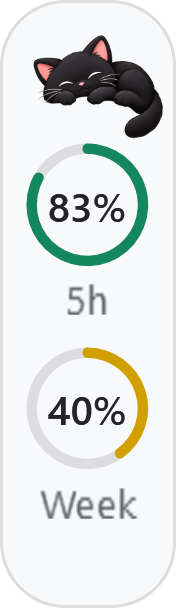
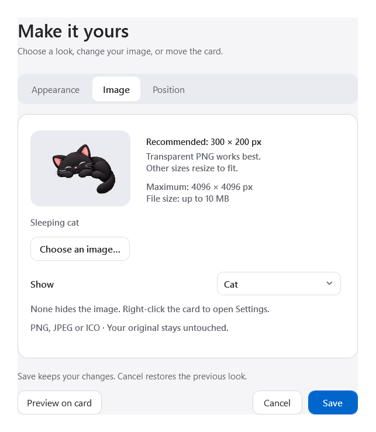
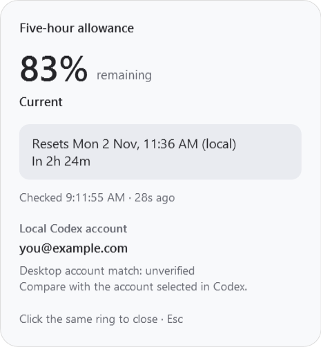

# Codex Usage Overlay for Windows

A small, unofficial Windows companion showing your remaining **five-hour** and **weekly** Codex allowance above the profile area. Includes a sleeping cat, custom images, automatic ring colours, reset details and light/dark appearance.

This project is independent of OpenAI and does not modify the Codex application.

## Screenshots

| Slim widget | Image settings | Click for usage details |
| --- | --- | --- |
|  |  |  |

All pictures use **sample usage and a fictional account**. Your own percentages and reset times will differ. Click a picture to view it at full size.

## Download and run

**[Download the Windows x64 portable ZIP](https://github.com/yijong1115/codex-usage-overlay/releases/latest)**

1. Install the official **Codex desktop app for Windows** and sign in with your own ChatGPT account.
2. Download `CodexUsageOverlay-1.0.0-windows-x64.zip` from Releases. Extract the whole folder somewhere writable and permanent, such as a folder under your Documents. Do not run it inside the ZIP.
3. Double-click **Start.cmd**, or open `out\CodexUsageOverlay.exe`.
4. Bring the Codex main window to the front. The card appears near the bottom-left profile area. The first account/usage check may take a few seconds.

Requires Windows x64 and the .NET Framework 4.8.1 desktop runtime. Tested on Windows 11 x64. No Python, Node, SDK, API key or administrator access is needed to run the portable build. ARM and older Windows versions are not tested. Executables are unsigned; source is provided so you can inspect and build them yourself.

Keep `out` and `assets` together in the extracted folder. Each person uses their **own** Codex account; this download contains no account or sign-in details. Startup is **off by default**.

## Controls

| Action | What it does |
| --- | --- |
| Click a percentage | Opens its reset time, last-check status and usage-account details |
| Click the same percentage again | Closes those details |
| Press Esc | Closes usage details or cancels Settings |
| Click the cat or your custom image | Opens Settings on the Image tab |
| Right-click the card | Settings, Refresh now, Reposition card, Pause / resume or Quit |
| Right-click its icon near the Windows clock | The same controls, default-position reset, startup and uninstall |

Hovering does not open details. The widget hides when Codex is minimized or another app is active. Mouse clicks do not leave a blue selection outline; keyboard navigation retains a focus cue.

**To close:** right-click → Quit. **To reopen:** run Start.cmd again. **To hide temporarily:** Pause display; use the notification-area icon to Resume display.

## Make it yours

Settings has **Appearance**, **Image** and **Position** tabs. Preview on card tries your changes; Save keeps them and Cancel restores the previous appearance.

- Choose System, Light or Dark and a Slim, Readable or Custom size.
- Rings follow the displayed percentage **remaining**: **70–100% green**, **30–69% yellow**, **below 30% red**. Threshold colours can be customised. Turn off Automatic ring colours for fixed per-ring colours.
- Choose a PNG, JPEG or ICO image. **300 × 200 px with a transparent PNG background is recommended**; other sizes resize to fit. Maximum 4096 × 4096 px and 10 MB. A local copy is kept; your original stays untouched.
- Save & move card lets you drag it. Release to save. Reset position returns it above the profile. Fine-tune position gives exact offsets.
- Selecting None hides the image; right-click the card to reopen Settings.

The card is positioned relative to the Codex window. Different app layouts, zoom settings or larger custom sizes may need repositioning. If it disappears after a position change, use the notification-area icon → Restore default position.

## What the numbers mean

Both rings show **remaining allowance**, not tokens used. Reset times use your local timezone. While active, usage normally refreshes every 60 seconds, on supported notifications, on resume and near a reported reset. You can also choose Refresh now.

An unavailable value appears as `—`, not zero. A successful read older than 150 seconds becomes stale. Reaching a reset time does not automatically fill a ring; the next successful read confirms the allowance.

The widget starts a hidden copy of the **official installed Codex app-server**, communicating through private stdin/stdout. It reads account and rate-limit metadata. It makes no model requests and does not spend model tokens or reset credits. The official Codex process handles sign-in and contacts OpenAI normally. The separate helper adds some RAM usage; its memory footprint depends on the local environment. After about a minute inactive the helper closes; Quit closes the companion and its helper.

### “Desktop account match: unverified”

The account shown in the details is the **local account supplying the usage data**. The widget checks stable account/workspace identifiers around each quota read, but cannot independently confirm which account is selected inside the desktop UI. Compare the displayed email and workspace with your Codex profile, especially if you use several accounts or workspaces. “Unverified” does not report a confirmed mismatch.

This integration depends on the installed Codex app-server protocol. A future Codex update may require a widget update. Missing or unverifiable source identity hides the readings rather than presenting an old account's allowance.

## Optional startup and removal

Enable **Start at Windows sign-in** in Settings or the notification-area menu. This creates one per-user Windows Startup shortcut and applies immediately. It starts the widget silently at your next sign-in and waits for Codex; it does not start Codex itself. Keep the folder in place. If you move it, enable startup again to repair its target.

To remove it, choose **Uninstall…** from the notification-area menu. This removes only its own startup shortcut, exits, and lets you keep or remove local preferences and copied images. Then delete the extracted folder if you no longer need it. Codex and unrelated startup entries are untouched.

## Build from source

Download this repository through **Code → Download ZIP**, or:

```powershell
git clone https://github.com/yijong1115/codex-usage-overlay.git
cd codex-usage-overlay
powershell -NoProfile -ExecutionPolicy RemoteSigned -File .\run-tests.ps1
powershell -NoProfile -ExecutionPolicy RemoteSigned -File .\build.ps1
```

The scripts use the installed .NET Framework compiler and WPF; there are no NuGet dependencies. `RemoteSigned` applies only to that PowerShell process. Downloaded scripts may require review and file unblocking under your Windows policy. Do not change machine-wide security settings for this widget. Quit the overlay before rebuilding its executable.

To create a portable ZIP from a clean source checkout:

```powershell
powershell -NoProfile -ExecutionPolicy RemoteSigned -File .\package.ps1 -Version 1.0.0
```

Packaging copies an explicit file list, including default art but **no `data` directory, settings, imported images, logs or test fixtures**. SHA-256 checksums are supplied with releases. See [PRIVACY.md](PRIVACY.md) for the data flow and publication exclusions and [docs/TESTING.md](docs/TESTING.md) for verification limits.

## Copy this to your AI assistant

```text
Help me set up this Windows widget:
https://github.com/yijong1115/codex-usage-overlay

Read README.md and PRIVACY.md first. Check that this is a suitable Windows
x64 machine with the official Codex desktop app and .NET Framework 4.8.1.
Review the source, then download the portable ZIP from this repository's
Releases and verify its published SHA-256, or build from source with the
included scripts. Extract the complete folder before launching it.
Use my own existing Codex sign-in; do not ask for API keys or copy anyone
else's credentials. Do not change machine-wide security settings, modify
Codex, or enable Windows startup unless I ask. Explain how to launch,
customise, quit and remove it.
```

Repository link to share: **https://github.com/yijong1115/codex-usage-overlay**

## Licence

[MIT](LICENSE). Code may be used, modified and redistributed under that licence. The bundled cat is AI-generated. Codex and OpenAI names belong to their respective owners.

